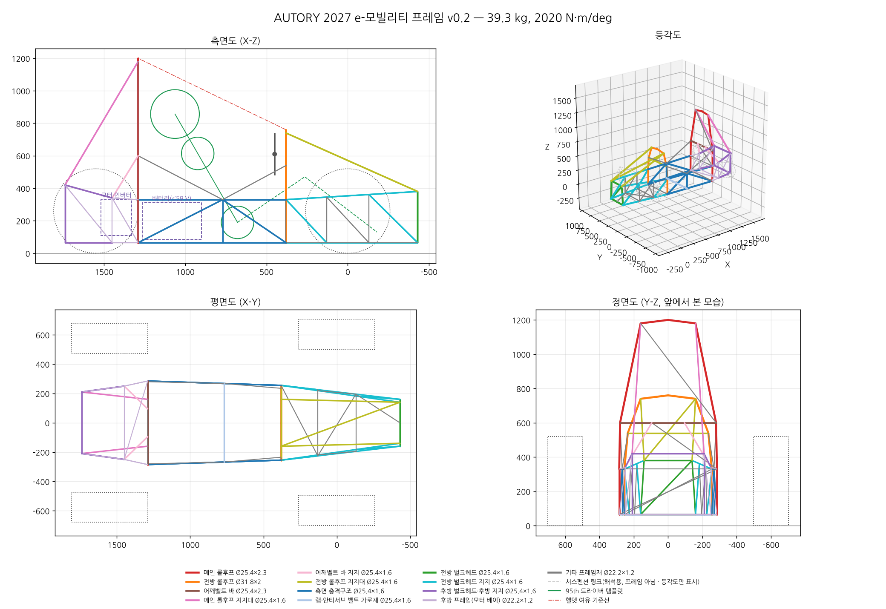

# AUTORY 26th — 2027 대학생 스마트 e-모빌리티 경진대회

## 프레임 설계 v0.1

강관 스페이스프레임을 파라메트릭으로 생성하고, 규정 체크와 3D 골조 구조해석을 한 번에 돌리는 도구와 1차 설계안.

- 설계보고서: [docs/프레임_설계보고서.md](docs/프레임_설계보고서.md)
- 결과 요약(자동 생성): [output/summary.md](output/summary.md)
- 3D 뷰어: `viewer/index.html` (`python build_viewer.py`로 다시 생성, 브라우저에서 바로 열림)

| | 현재 설계안 |
|---|---|
| 프레임 질량 | 41.9 kg (용접·탭 10 % 포함) |
| 비틀림 강성 | 2,186 N·m/deg |
| 휠베이스 / 윤거 | 1,550 / 1,200 · 1,150 mm |
| 재료 | STKM13C, Ø31.8×2.0 · Ø25.4×2.3 · Ø25.4×1.6 · Ø22.2×1.2 |

> 규정값 상당수는 2027 규정집 원문과 대조하기 전이다(보고서 4장의 확인 상태 참고).



## 실행

```bash
pip install -r requirements.txt
```

```bash
python run_frame.py
```

```bash
python tests/test_fea.py
```

## 수정 방법

- 규정값: `frame/config.py`의 `RULES`
- 형상: `frame/config.py`의 `Params`(휠베이스, 후프 위치·높이, 드라이버 자세, 보강 옵션)
- 튜브 규격·그룹: `frame/config.py`의 `TUBES`, `GROUPS`
- 부재 연결: `frame/geometry.py`
- 하중 조건: `frame/loadcases.py`

값을 바꾸고 `python run_frame.py`를 다시 실행하면 `output/` 전체가 갱신된다.

## 출력 파일 (`output/`)

| 파일 | 내용 |
|---|---|
| `frame_overview.png` | 측면·평면·정면·등각도, 95th 드라이버 템플릿, 패키징 영역 |
| `safety_factors.png` | 하중 조건별 부재 안전율 |
| `*_deformed.png` | 비틀림, 메인 롤후프, 측면 충돌 변형 형상 |
| `summary.md`, `results.json` | 질량, 강성, 하중 조건별 결과, 체크리스트, 강관 소요량 |
| `nodes.csv` | 하드포인트 좌표 (X 뒤+, Y 왼쪽+, Z 위+, mm, 앞차축 중심·지면 원점). 이 축 방향은 왼손 좌표계라 CAD(오른손)로 가져오면 `_L` 노드가 오른쪽에 보인다. 좌우 대칭이라 해석에는 영향 없음 |
| `cut_list.csv` | 부재별 규격, 중심선 길이, 질량, 양 끝 좌표 |
| `frame_centerlines.dxf` | 3D 중심선(레이어 = 부재 그룹). CAD에서 3D 스케치로 가져와 용접 구조물 모델 생성 |
| `frame.json` | 3D 뷰어용 데이터 |

## 구조

```
frame/
  config.py     규정(출처·확인 상태), 재료, 튜브, 차량·형상 파라미터, 질량
  geometry.py   노드·부재 생성(좌우 대칭), 드라이버 템플릿
  fea.py        3D 보·트러스 선형 정적 해석기(numpy)
  loadcases.py  하중 조건 10종
  checks.py     형상·규정 체크
  plots.py      그림
  export.py     CSV / DXF / JSON
run_frame.py    전체 실행
build_viewer.py 3D 뷰어 생성 (viewer/template.html → viewer/index.html)
tests/          해석기 검증(이론식 비교)
docs/           설계보고서
```
