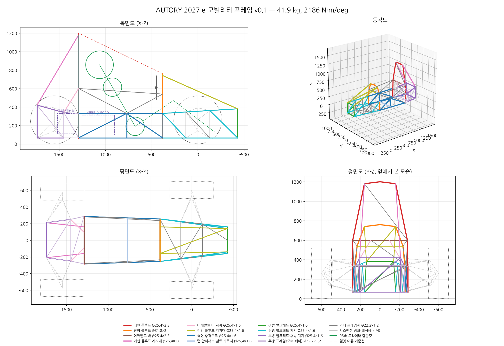
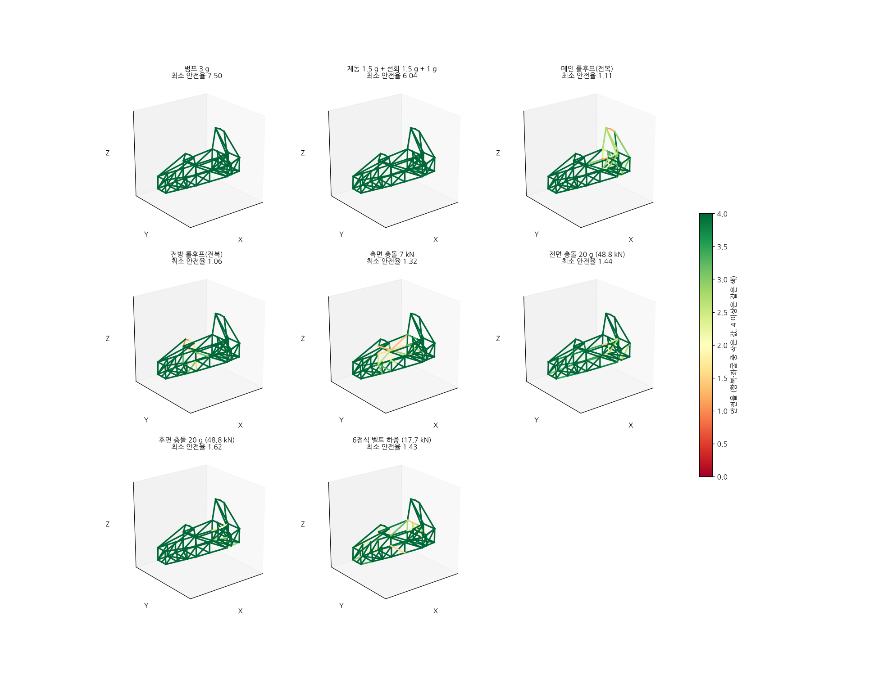
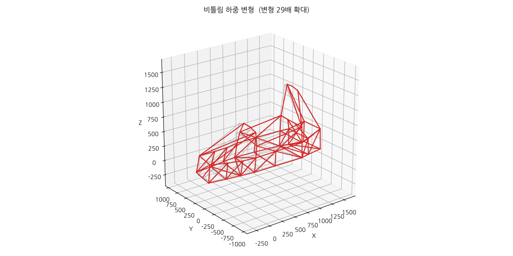

# AUTORY 2027 대학생 스마트 e-모빌리티 경진대회 — 프레임 설계 v0.1

> 작성일 2026-11-05 · 상태: **1차 개념설계(규정 원문 대조 전)**
> 해석 수치는 모두 `python run_frame.py` 결과([output/summary.md](../output/summary.md))와 같다.

## 1. 요약

| 항목 | 값 |
|---|---|
| 형식 | 강관 TIG 용접 스페이스프레임 (FSAE형, 참고 사진 GRC27과 같은 방식) |
| 재료 | STKM13C (KS D 3517), 항복 380 MPa / 인장 510 MPa |
| 휠베이스 / 윤거(앞·뒤) | 1,550 mm / 1,200 · 1,150 mm |
| 프레임 외곽(튜브 중심선) | 길이 2,170 × 폭 570 × 높이 1,200 mm |
| 프레임 질량 | **41.9 kg** (튜브 38.1 kg + 용접·탭 10 %) |
| 비틀림 강성 | **2,186 N·m/deg** (목표 1,500 이상) |
| 차량 질량(드라이버 90 kg 포함, 가정) | 249 kg, 앞축 41.5 %, 무게중심 높이 211 mm |
| 체크리스트 | 46개 중 45개 통과 · 미달 1개: 프레임 질량(자체 목표 35 kg) |

10개 하중 조건(비틀림, 1 g 굽힘, 범프 3 g, 제동+선회, 메인·전방 롤후프 전복, 측면·전면·후면 충돌, 6점식 벨트)에서 모든 부재의 항복 안전율이 1 이상이고, 좌굴 이용률은 0.26 이하다.

**한계.** 2027 규정 원문을 아직 보지 못했다(3장). 롤후프·튜브 두께 같은 핵심 수치는 KSAE의 다른 부문 규정과 FSAE 관례에서 빌려 왔다. 규정집을 받으면 `frame/config.py`의 `RULES` 값만 고치고 다시 실행하면 된다.

---

## 2. 대회 개요 (조사 결과)

- 명칭: 대학생 스마트 e-모빌리티 경진대회. 원래 KSAE 대학생 자작자동차대회의 EV 부문이었다.
- 주최·주관: 전라남도, 영광군, 한국자동차공학회(KSAE), 한국자동차연구원(KATECH)
- 2026 대회: 10월 2~4일, 영광 KATECH 전남분원. 38~39개 대학 45~46개 팀이 참가했다(기사마다 수치가 다름).
- 평가 종목: 가속, 짐카나, 주행성능, 내구레이싱, 전비효율
- 동력 제한(2026 보도): 모터 10 kW 이하, 배터리 59 V 이하

### 2026 대회 규정 변경점 (언론 보도로 확인)

| 항목 | 이전 | 2026 | 프레임 설계에 미치는 영향 |
|---|---|---|---|
| 휠베이스 | ≥ 1,250 mm | **≥ 1,500 mm** | 차체가 FSAE급으로 커짐 → 1,550 mm로 설계 |
| 타이어 폭 | ≥ 125 mm | **≥ 200 mm** | 13인치 8.0폭 타이어 가정(Ø520) |
| 안전벨트 | 4점식 | **6점식** | 어깨 2·랩 2·안티서브 마운트 필요 |
| 범퍼 | — | **전·후면 충격완화장치** | 전·후방 벌크헤드를 범퍼 마운트면으로 설계 |
| 제동등 | — | 15 W 이상 | (전장) |
| 안전구조 심사 | — | 프레임 강성, 전후면 범퍼, 롤후프 기준 강화 | 해석 근거 자료 준비 필요 |
| HV/LV | — | 배치·안전장치 기준 강화 | 배터리 위치·방화벽 확인 필요 |

---

## 3. 자료 조사 범위와 한계

요청받은 링크와 대회 공식 사이트는 이 작업 환경의 네트워크 정책에 막혀 **열지 못했다.**

| 자료 | 상태 |
|---|---|
| KSAE 공식 사이트(ksae.org, 자작자동차대회 게시판·규정·우수보고서) | 접속 불가 |
| Naver 블로그 5곳(dokon2567, semin1227, gimdeok, jih001029, mlee4859kmh) | 접속 불가 |
| dnf.luftaquila.io, fsk.luftaquila.io(FSK 규정 PDF) | 접속 불가(검색 발췌만 확인) |
| studocu의 EV 규정(2022.11.17 시행) 사본 | 접속 불가(검색 발췌만 확인) |
| MathWorks Kinematic Steering | 접속 시도 안 함(9장에 Ackermann 계산 반영) |
| 뉴스 기사, 논문 초록 | 웹 검색 결과로 확인 |

**우수 설계보고서는 하나도 확보하지 못했다.** 규정집 PDF와 우수보고서를 저장소 `docs/ref/`에 넣어 주거나, 환경 설정에서 위 도메인을 허용해 주면 대조해서 v0.2를 만들겠다.

---

## 4. 설계 기준 (규정 정리)

`frame/config.py`의 `RULES`와 같은 내용이다. 확인 상태는 네 단계로 나눴다.

- **확인**: 2026 언론 보도로 확인
- **EV 일부**: EV 규정 발췌로 확인
- **KSAE 차용**: 같은 학회의 Formula·Baja 규정 수치를 빌려 옴
- **FSAE 차용**: FSAE 관례값을 빌려 옴

| 항목 | 기준값 | 출처 | 상태 |
|---|---|---|---|
| 휠베이스 | ≥ 1,500 mm | 2026 보도 | 확인 |
| 타이어 폭 | ≥ 200 mm | 2026 보도 | 확인 |
| 안전벨트 | 6점식 | 2026 보도 | 확인 |
| 전·후면 범퍼 충격완화장치 | 필수 | 2026 보도 | 확인 |
| 모터 / 배터리 | ≤ 10 kW / ≤ 59 V | 2026 보도 | 확인 |
| 롤후프 강관 외경 | ≥ 25 mm | EV 규정(2022) 발췌 | EV 일부 |
| 메인·전방 롤후프, 어깨벨트 바 | ≥ Ø25 × 1.8 | FSK 2026 표, Baja 2020, KASA | KSAE 차용 |
| 지지대·측면·전방 충격구조 | ≥ Ø25 × 1.6 | FSK 2026 표 | KSAE 차용 |
| 기타 프레임재 | ≥ Ø20 × 1.2 | FSK 2026 표 | KSAE 차용 |
| 강관 재료 | 탄소강, 항복 ≥ 285 MPa, 인장 ≥ 360 MPa | Baja 2020(KASA는 300 / 365 MPa) | KSAE 차용 |
| 헬멧 여유 | 롤후프 상단 연결선에서 50.8 mm 이상 | FSAE 95th 템플릿 | FSAE 차용 |
| 메인 후프 지지대 | 후프와 30° 이상, 상단 160 mm 이내에 부착 | FSAE | FSAE 차용 |
| 전방 후프 ~ 스티어링 휠 | 휠 상단 이상 높이, 휠보다 250 mm 이내로 앞 | FSAE | FSAE 차용 |
| 어깨벨트 | 수평 +10° ~ −20°, 마운트 간격 178~229 mm | FSAE | FSAE 차용 |
| 랩벨트 | 측면도 45~65° | FSAE | FSAE 차용 |
| 전복·측면 하중 시 변위 | ≤ 25 mm | FSAE SES | FSAE 차용 |
| 비틀림 강성 | ≥ 1,500 N·m/deg | 자체 목표 | — |
| 안전율(항복) | 주행 ≥ 1.5, 충돌·전복 ≥ 1.0 | 자체 목표 | — |

> 규정을 받으면 먼저 확인할 것: 롤후프 두께, 95th 템플릿 규정 여부, 범퍼·충격완화장치의 시험 조건(속도·감속도), 프레임 강성 심사 방법, 배터리 위치 제한.

---

## 5. 프레임 구성

좌표계: X는 앞차축에서 뒤쪽(+), Y는 왼쪽(+), Z는 지면에서 위(+), 단위 mm. 모든 하드포인트는 [output/nodes.csv](../output/nodes.csv)에 있다.

| 구역 | X 범위 | 구성 | 역할 |
|---|---|---|---|
| 전방 벌크헤드 | −430 | 320(하)·280(상) × 315 사각 + 대각 | 전면 범퍼·충격완화장치 마운트, 페달 박스 앞면 |
| 전방 박스 | −430 ~ 380 | 상·하 레일 + Warren 대각, 바닥 가로재·대각, **윗면 대각** | 앞 서스펜션 마운트(X = −130 / +130), 스티어링 랙 |
| 전방 롤후프 | 380 | **Ø31.8×2.0** 한 개를 굽혀 만듦, 상단 Z 760, 대시바 Z 540 | 전복 보호, 스티어링 컬럼 마운트 |
| 콕핏 | 380 ~ 1,290 | 하부 레일(Z 65), 측면충격 상부재(Z 330), 대각, 콕핏 레일 | 측면 충돌, 랩벨트 마운트(X 770) |
| 메인 롤후프 | 1,290 | Ø25.4×2.3, 상단 Z 1,200, 어깨벨트 바 Z 600, 헤드레스트 뒤 대각 | 전복 보호, 어깨벨트, 방화벽면 |
| 메인 후프 지지대 | 1,290 → 1,740 | 후프 상단 모서리에서 후방 벌크헤드 상단으로 | 각도 30.6° |
| 후방 모터 베이 | 1,290 ~ 1,740 | 상·하 레일, 측면 대각, 후방 벌크헤드 + 대각 | 모터·감속기, 뒤 서스펜션(X 1,450 / 1,740), 후면 범퍼 |

### 형상을 정한 이유

1. **드라이버 배치가 높이를 정했다.** 95th 템플릿(엉덩이 Ø200, 어깨 Ø200, 헬멧 Ø300, 중심 간 490 / 280 mm)을 페달 면에서 915 mm 거리에 두고 상체를 30° 눕혔다. 헬멧이 전방·메인 후프 연결선에서 50.8 mm 이상 떨어지려면 메인 후프 상단이 1,200 mm는 돼야 한다. 결과 여유는 60.3 mm다.
2. **메인 후프는 수직, 지지대는 상단 모서리에 붙였다.** 지지대를 후프 최상단에서 50~120 mm 아래에 붙인 초기안은 전복 하중에서 상단부 안전율이 0.33~0.49였다. 모서리에 직접 붙이고 헤드레스트 뒤에 대각을 넣어 1.11이 됐다.
3. **비틀림 강성은 전방 박스 윗면 대각 하나가 좌우한다.** 이 부재 하나로 1,516에서 2,186 N·m/deg로 오른다(+44 %). 무릎 위로 지나가며, 무릎과의 최소 간격은 62 mm(대시바 기준)로 확인했다.
4. **전방 롤후프만 Ø31.8로 키웠다.** 전복 횡하중(5 kN)에서 대시바 아래 다리 구간이 굽힘으로 지배된다. 그런데 이 구간은 허벅지가 지나가는 자리라 대각을 넣을 수 없다. Ø25.4×2.3은 안전율 0.79, Ø28.6×2.3은 0.97, **Ø31.8×2.0은 1.06**이고, 가장 가벼운 조합이다.
5. **콕핏 바닥 대각은 뺐다.** 부재별 비틀림 기여도를 계산해 보니 4개 합쳐 약 20 N·m/deg(1 %)인데 무게는 1.3 kg이었다.

### 패키징

| 부품 | 위치 | 비고 |
|---|---|---|
| 배터리(≤ 59 V, 22 kg 가정) | 시트백 뒤 쐐기 공간, X 900~1,265, Z 85~310 | 무게중심이 낮고 중앙에 옴. 방화벽면(메인 후프면)으로 분리. **HV/LV 배치 규정 확인 필요** |
| 모터·인버터(20 kg) | 후방 베이, X 1,330~1,520 | 체인 구동, 후차축 X 1,550 |
| 스티어링 랙 | 전방 박스, 앞차축 부근 | 컬럼은 대시바(Z 540) 위로 통과 |
| 페달 박스 | 벌크헤드 ~ X −230 | 페달 면에서 엉덩이 중심까지 915 mm |

---

## 6. 튜브 · 재료

| 그룹 | 규격 | 개수 | 비고 |
|---|---|---:|---|
| 전방 롤후프 | Ø31.8 × 2.0 | 8 | 하나로 굽힌 튜브(해석은 폴리라인 근사) |
| 메인 롤후프, 어깨벨트 바 | Ø25.4 × 2.3 | 11 | 규정 하한 1.8보다 두꺼움(전복 하중 여유) |
| 지지대, 측면충격, 전방 벌크헤드·지지, 후방 벌크헤드, 벨트 가로재 | Ø25.4 × 1.6 | 55 | 규정 하한 그대로 |
| 기타(모터 베이, 바닥, 대각 등) | Ø22.2 × 1.2 | 38 | 기타 프레임재 하한 Ø20 × 1.2 이상 |

강관 소요량은 6 m 정척 기준 Ø31.8 1본, Ø25.4×2.3 1본, Ø25.4×1.6 5본, Ø22.2×1.2 4본이다(손실 15 % 포함). 절단 목록은 [output/cut_list.csv](../output/cut_list.csv)에 있고, 길이는 중심선 기준이다. 노칭 형상은 CAD에서 만든다.

**재료 선택.** STKM13A는 항복강도 215 MPa로, 빌려 온 규정의 285 MPa에 못 미친다. 그래서 **13C**를 기본으로 했다. 4130 크로몰리로 바꾸면 강도는 오르지만 규정 최소 두께 때문에 무게는 거의 줄지 않는다. 대신 TIG 용접 품질 관리가 더 어려워진다.

---

## 7. 구조 해석

### 방법

- 자체 작성한 3D 골조 해석기(`frame/fea.py`): Euler-Bernoulli 보 요소 사용, 노드당 6 자유도, numpy 선형 정적해석
- 서스펜션(위시본, 푸시로드, 업라이트, 타이로드)은 축력만 받는 강체 링크로 넣었다. 비틀림·주행 하중이 실제 하드포인트로 들어가게 하기 위해서다(댐퍼는 잠금).
- 응력은 축력과 굽힘을 외곽 섬유에서 합산하고 비틀림 전단을 더한 von Mises로 계산했다. 용접부 응력집중은 반영하지 않았다.
- 좌굴은 부재별 오일러 좌굴하중(K = 1)으로 확인했다.
- 해석기 검증(`tests/test_fea.py`): 외팔보 처짐, 비틀림각, 대칭 반력을 이론식과 비교해 오차 1e-9 이내다.

### 하중 조건

| 조건 | 하중 | 구속 | 근거 |
|---|---|---|---|
| 비틀림 | 앞바퀴 중심 ±1 kN (1,200 N·m) | 뒷바퀴 중심 핀, 벌크헤드 중앙 Z | 업계 표준 시험법 |
| 1 g / 범프 3 g | 스프링 상질량 + 자중 | 네 바퀴 중심 핀 | 가정 |
| 제동 + 선회 | 1.5 g 앞, 1.5 g 옆, 1 g 아래 | 네 바퀴 중심 핀 | 가정 |
| 메인·전방 롤후프 | Fx 6, Fy 5, Fz −9 kN (상단 직선부에 분포) | 두 후프 하단 변위 고정 | FSAE SES 관례 |
| 측면 충돌 | 7 kN (측면충격구조 3점) | 반대쪽 서스펜션 마운트 | FSAE SES 관례 |
| 전면 / 후면 충돌 | 249 kg × 20 g = 48.8 kN (벌크헤드 4점) | 메인 후프 하단·지지대 / 메인 후프 하부 | 충격완화장치 평균 감속 20 g 가정 |
| 6점식 벨트 | 드라이버 90 kg × 20 g = 17.7 kN | 전방 벌크헤드(범퍼 반력) | 어깨 2×20 %, 랩 2×25 %, 안티서브 10 % |

### 결과

| 조건 | 최대 변위 (mm) | 최소 안전율 | 취약 부재 | 좌굴 이용률 |
|---|---:|---:|---|---:|
| 비틀림 | 3.65 | 2.18 | 전방 박스 상부 레일 | 0.12 |
| 1 g 굽힘 | 0.18 | 22.5 | 벨트 가로재 | 0.02 |
| 범프 3 g | 0.54 | 7.5 | 벨트 가로재 | 0.05 |
| 제동 + 선회 | 0.84 | 6.04 | 콕핏 하부 레일 | 0.05 |
| 메인 롤후프 | 5.49 | **1.11** | 후프 상단 직선부 | 0.26 |
| 전방 롤후프 | 4.04 | **1.06** | 후프 다리(대시바 아래) | 0.19 |
| 측면 충돌 | 5.41 | 1.32 | 콕핏 측면 상부 대각 | 0.12 |
| 전면 충돌 | 5.69 | 1.44 | 모터 베이 상부 레일 | 0.19 |
| 후면 충돌 | 1.86 | 1.62 | 모터 베이 상부 레일 | 0.09 |
| 6점식 벨트 | 6.98 | 1.43 | 어깨벨트 바 | 0.14 |

비틀림 강성은 **2,186 N·m/deg**, 질량당 52 N·m/deg/kg이다. 비틀림각은 콕핏 구간(X 380~1,290)에서 가장 많이 생긴다. 윗면이 열린 구간이라서다.

> 해석 결과의 한계: 선형 보 모델이라 용접부·노칭부 응력집중, 탭 국부 굽힘, 소성 붕괴는 반영하지 않았다. 롤후프 안전율 1.06~1.11은 여유가 작으므로, 규정 원문의 하중 조건을 확인한 뒤 ANSYS/HyperWorks 같은 상용 해석으로 교차 검증해야 한다. 2024년에는 KSAE 자작자동차대회 참가팀 대상 Altair 라이선스 지원 프로그램이 있었다(2027 지원 여부는 확인 필요).

---

## 8. 무게 줄이기 (자체 목표 35 kg 미달)

현재 41.9 kg으로 목표보다 6.9 kg 무겁다. 후보는 다음과 같다.

| 방법 | 예상 감량 | 조건 |
|---|---:|---|
| 규정에 전복 하중 해석이 없으면 전방 후프를 Ø25.4×2.0, 메인 후프를 ×2.0으로 | ~1.0 kg | 규정 원문 확인 |
| 기타 프레임재 Ø22.2×1.2 → Ø20×1.2 (재고 확인) | ~1.1 kg | 국내 유통 확인 |
| 후방 벌크헤드·레일을 Ø22.2×1.2로 (후면 충돌 안전율 1.62 → 1.39) | ~1.2 kg | 후면 범퍼 규정 확인 |
| 측면충격구조의 중간 노드·수직재 정리 | ~0.5 kg | 랩벨트 마운트 위치 재설계 |
| 용접·탭 할증 10 % → 실측 | ±1 kg | 시제작 |

모두 적용해도 38 kg 안팎이 현실적이다. 35 kg에 도달하려면 규정이 허용하는 범위에서 콕핏 길이(910 mm)를 줄이는 등 드라이버 패키징부터 다시 봐야 한다.

---

## 9. 조향 기하 참고 (MathWorks Kinematic Steering 블록과 같은 Ackermann 관계)

킹핀 간격 약 1,060 mm, 휠베이스 1,550 mm일 때 이상 Ackermann은 cot δo − cot δi = 1,060 / 1,550이다.

| 안쪽 바퀴 조향각 δi | 바깥쪽 δo | 바깥 바퀴 회전반경 |
|---:|---:|---:|
| 20° | 16.2° | 6.1 m |
| 25° | 19.5° | 5.2 m |
| 30° | 22.5° | 4.6 m |
| 35° | 25.3° | 4.2 m |

짐카나 코스를 생각하면 안쪽 바퀴 30~35°는 필요해 보인다. 랙·타이로드 위치를 정한 뒤 전방 박스의 FL/FU 노드에 랙 마운트 탭을 추가하면 된다.

---

## 10. 제작 가이드 (참고 사진 방식)

1. **지그 테이블**: 18 mm 합판이나 MDF 위에 측면도·평면도 노드 좌표를 1:1로 출력하거나 CNC로 새긴다. 벌크헤드와 후프 위치에 합판 지그 블록을 세운다. 사진처럼 래칫 스트랩과 클램프로 튜브를 고정한다.
2. **후프 벤딩**: 메인·전방 후프를 먼저 굽힌다. 벤딩 반경은 외경의 3배 이상으로 하고, 굽힌 뒤 1:1 템플릿으로 검사한다. 두께 검사 구멍이 필요한지 규정을 확인한다.
3. **조립 순서**: 바닥 레일·가로재 → 전방 벌크헤드·전방 박스 → 전방 후프 → 콕핏 측면 → 메인 후프·지지대 → 후방 베이 → 탭(서스펜션·벨트·범퍼·모터) 순으로 진행한다.
4. **노칭**: 튜브 노처를 쓰거나 파이프 레이저 가공을 외주한다. 절단 목록 길이는 중심선 기준이다.
5. **용접**: TIG를 쓴다. 전체를 가접한 뒤 대각선 길이를 측정하고 본용접한다. 열변형을 줄이려면 좌우를 번갈아 짧게 용접한다.
6. **검사**: 하드포인트 ±1 mm, 대각선 길이 차이 ±2 mm를 기준으로 한다. 완성 후 실측 비틀림 시험으로 해석값(2,186 N·m/deg)과 비교한다.

---

## 11. 다음 단계

1. **2027 규정집 원문 확보 → `RULES` 갱신 → 재해석** (가장 중요)
2. 우수 설계보고서를 확보해 하중 조건과 경계조건을 대회 관례에 맞추기
3. 서스펜션 하드포인트(롤센터, 캠버 게인)를 확정한 뒤 FL/FU/RL/RU 노드 위치 반영
4. 실제 드라이버 체격 측정(팀원 최대 체격)과 95th 템플릿 비교
5. 배터리 박스, 모터 마운트, 범퍼 충격완화장치를 상세 설계하고 탭 설계
6. DXF 중심선을 CAD(SolidWorks, Fusion 등)로 가져와 용접 구조물 모델을 만들고 상용 FEA로 교차 검증

---

## 참고 자료

**대회 · 규정 (검색으로 확인)**
- [위키트리 — 2026 대회 규정 강화(프레임 강성·범퍼·롤후프)](https://www.wikitree.co.kr/articles/1164426)
- [파이낸셜뉴스 — 2026 대회 결과](https://www.fnnews.com/news/202610070909458987) · [오토뷰 — 평가 종목](https://www.autoview.co.kr/ko-kr/articles/101990)
- 2026 대회 사전 보도(휠베이스·타이어·제동등·6점식·범퍼·10 kW/59 V): [중앙이코노미뉴스](https://www.joongangenews.com/news/articleView.html?idxno=550980), [전남일보](https://www.jnilbo.com/news/articleView.html?idxno=90000069232), [아시아경제](https://view.asiae.co.kr/article/2026093016000176473) — 검색 요약으로 확인했으므로 기사 원문 대조가 필요하다.
- [FSK 2026 차량기술규정 PDF](https://fsk.luftaquila.io/rules/improved/2026/formula.2026.pdf) (원문 접속 불가, 발췌만 확인)
- [EV 차량기술규정(2022) 사본 — studocu](https://www.studocu.com/ko/document/wonkwang-university/robotics-and-machine-vision/%EA%B7%9C%EC%A0%95-ev-%EC%B0%A8%EB%9F%89%EA%B8%B0%EC%88%A0%EA%B7%9C%EC%A0%952023-ddddd/124104098)
- [Baja 2020 규정 사본 — studocu](https://www.studocu.com/ko/document/yeungnam-university/%EA%B3%B5%ED%95%99%EB%8F%84%EB%A5%BC-%EC%9C%84%ED%95%9C-%EC%A0%84%EA%B8%B0%EC%A0%84%EC%9E%90%EA%B3%B5%ED%95%99/%EA%B7%9C%EC%A0%95-%EC%9E%90%EC%9E%91%EC%B0%A8-baja-%EC%B0%A8%EB%9F%89%EA%B8%B0%EC%88%A0%EA%B7%9C%EC%A0%952020/73026187) · [KSAE 자작자동차대회 Q&A](https://ksae.org/jajak/bbs/?category=&code=J_qna&gubun=&keyfield=&keyword=&mode=view&number=54270) · [KASA 2020 규정](http://www.kasa.kr/cev/02rule02.php)

**설계 참고**
- [초소형 전기차 공용 플랫폼용 프레임의 강성 설계 (DBpia)](https://www.dbpia.co.kr/journal/articleDetail?nodeId=NODE11035108)
- [포뮬러 형태 자작자동차의 경량화 및 주행 성능 향상 (한국산학기술학회)](https://www.kais99.org/jkais/journal/Vol18No10/vol18no10p84.pdf)
- [Altair KSAE 자작자동차대회 라이선스 지원](https://web.altair.com/ksae-license-support-program-2024)
- [MathWorks Kinematic Steering](https://kr.mathworks.com/help/vdynblks/ref/kinematicsteering.html)
- 사용자가 제공한 블로그(접속 불가, 다음 버전에서 반영): blog.naver.com/dokon2567, semin1227(카테고리 8), gimdeok, jih001029/224022749099, mlee4859kmh/221747390011, dnf.luftaquila.io
